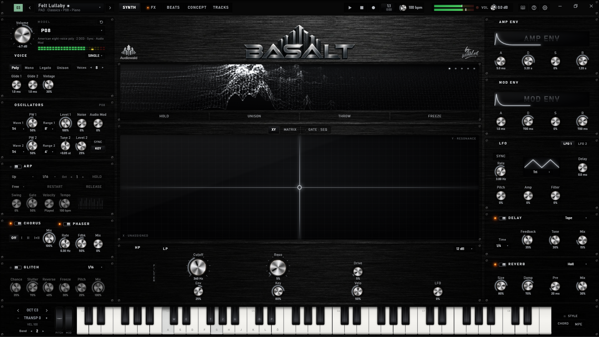

# Audiowald Basalt

**A music workstation (DAW) for Windows** - fourteen synth models, a pad sampler and drum machine, an
auto-accompaniment that follows your chords, multitrack recording and arranging, a song-writing assistant and a
complete piano course, in one app that runs offline.

  

This repository holds the versions only (no source code).

---

## Install

1. Download `Audiowald-Basalt-Setup-<version>.exe` from the newest entry under **Releases**.
2. Run it. If Windows warns ("Windows protected your PC"), choose **More info → Run anyway** - the test
   versions are not signed yet.
3. Start Basalt. In the demo the top bar shows **DEMO** with the time remaining in the session.
4. With a **licence key** (**ENTER KEY** in the top bar) Basalt runs without limit and fully offline. The
   same key works on your other computers too.

**Updates** come by themselves: when a new version is out, **UPDATE** appears in the top bar - DOWNLOAD,
then INSTALL. Basalt closes, updates silently and starts again. Your sounds, songs and settings stay.

**VST3 plugin:** at the first installation the setup asks whether Basalt should also be installed as a VST3
plugin for your DAW. It goes to `C:\Program Files\Common Files\VST3`, where DAWs look for plugins (Windows
asks for permission). In your DAW load **Audiowald Basalt** as an instrument. The same licence key unlocks the
app and the plugin.

---

## What makes Basalt different

Most DAWs give you a timeline, a mixer and a box of plugins - learning to play, writing the song and
finding the sound are left to you. Basalt builds these into the workstation itself:

| | A typical DAW | Basalt |
| --- | :---: | :---: |
| Timeline, piano roll, recording, mixing, export | ✓ | ✓ |
| Synthesizers built in | a few, or plugins | **14 models, 815 presets** |
| Pad sampler and drum machine | plugins or separate | **built in (BEATS)** |
| Auto-accompaniment that follows the chords you play, live | – | **158 styles in 15 genres** |
| Song planning: form, keys, chords, playing patterns → finished tracks | – | **CONCEPT + assistant** |
| Learn to play the piano inside the music program | – | **12 levels, live jam units** |
| One key plays a whole chord with voice leading | rarely | **CHORD** |
| Vocal tuning, vocal studio chain and vocoder | plugins | **built in (VOICE)** |
| Move sound in 3D with your hands in front of a camera | – | **✓** |
| Persian tuning (dastgāh, koron and sori notes) on every track | – | **✓** |
| Runs fully offline, no account | varies | **✓** |

### Only in Basalt

- **A piano teacher inside the DAW.** Falling notes, finger numbers and hand diagrams through twelve
  levels - and in every level *live units* with accompaniment: echo a call by ear, jam freely, find chords,
  groove in the pulse, play with both hands, invent a motif. The music waits for you or keeps going and
  rates your timing. Anything you improvise can be **kept as a song track** with one click.
- **Accompaniment that listens.** Pick a style, play a chord - drums, bass, chords, pad and an ostinato
  follow you, with intro, two main parts, fills and an ending. Like an arranger keyboard, but recorded
  straight into your song.
- **Write a song from its form.** CONCEPT plans sections, keys, chord palettes that only offer chords
  that fit, and playing patterns for keys, strumming and bass. A 14-step assistant guides you through it;
  **Create Arrangement** turns the plan into five editable tracks.
- **Your hands as a controller.** A webcam or a phone sees your arms and hands (only points, never a
  picture): raise them to move the sound through the room, stretch to widen it, open, pinch or tilt to
  turn any sound parameter.
- **Tuning beyond the piano.** Persian tuning with dastgāh and tonic: koron and sori notes sound lower or
  higher on every track, changeable while you play.
- **Cinematic movement.** Micro pitch drift, spectral lift and an endless rising tone - and a global pitch
  drift that moves the whole song together.

---

## All features

**Sound**
- Fourteen synth models: classic polysynths (Six, Six-0, Six-106, Jove 8, Oberon X, Prophetic 6, P08), a
  fat mono / poly synth (Voyage), six-operator FM (Hex 7), modern virtual analogue (Hyper), an acoustic
  **Piano** (physically modelled - strings, felt hammer, soundboard - or recorded Grand and Upright), sound
  clouds from recordings (Texture, Spectra) and a Sampler.
- 815 presets; every change you make to a preset is remembered.
- Two layers per sound (STACK or SPLIT), unison, glide, two LFOs, an 8-slot modulation matrix, XY pad.
- Arpeggiator, a 16-step SEQ that plays chords in your scale, an 8-step GATE.
- MPE controllers, MIDI keyboards, the on-screen keys or the computer keys.

**Effects**
- Chorus, phaser, tape / ping-pong delay, reverb and a per-track glitch (stutter, reverse, freeze, pitch).
- Ambient tools: fracture, grain, fold, resonator, spectral (smear, freeze, shift, morph) and space.
- Cinematic motion and global pitch drift; an analogue mastering stage (tube, tape, glue, width) and EQ.

**Chords and accompaniment**
- CHORD: one key plays triads, 7ths, 9ths, sus or power chords in your key and scale - with voicings,
  extra notes above or below, a bass note and automatic voice leading.
- STYLE: 158 accompaniment styles in 15 genres following the chord you play.

**BEATS**
- 9 to 32 pads: load or record sounds, chop them by hits or grid or live, assign slices to pads.
- Pattern recording with overdub, count-in and quantize; note repeat (also triplets), velocity and pitch
  levels, choke groups, one-shot / gate / loop pads.
- Ten drum tracks (synthesis and recorded strikes), 100 kits, four patterns up to eight bars, chains,
  drum bus and glitch. Write patterns into the song or resample them into a new sound.

**Song**
- CONCEPT and the Composition Assistant (see above).
- TRACKS: record keys, knob moves and the microphone; piano roll with chord tool, quantize and automation;
  arranger for whole bars across all tracks; faders, mute and solo; undo for the whole song.
- Export the song as WAV, MP3, OGG or FLAC, also every track as its own file.

**Voice**
- Tune your singing (natural or hard tune) to the key, the chord or the notes you play; a lead-vocal
  studio chain; formant, robot and harmony voices; a vocoder that lets your voice shape the synth.

**Learn**
- Twelve levels from the first three keys to your own performance; Wait for me, Play through or Listen;
  tempo, hands, sections and repeat; points, accuracy and timing; live units in every level; play freely
  over any piece and listen back.

**More**
- Assign buttons, faders and knobs of your MIDI controller with LEARN.
- The **?** in the top bar explains every page.

---

## Changelog

The same list is in Basalt: **Settings → CHANGELOG**.

### 0.2.5 - 2026-11-10

- VST3 plugin: the setup asks at the first installation whether Basalt should be installed as a VST3 plugin for your DAW too (C:\Program Files\Common Files\VST3). Updates renew it, uninstalling removes it.
- The plugin takes the same licence key as the app; without a key it runs 15 minutes per DAW session.
- Drum bus: the standard level is −9 dB (every drum kit, and double-click on Level).

### 0.2.4 - 2026-11-10

- Any MIDI keyboard works without setup: the knobs start with the General MIDI 2 controls (CC 74 cutoff, 71 resonance, 73 attack, 72 release, 91 reverb), transport buttons and faders work in the DAW mode most keyboards have and with MIDI Machine Control. Everything else: LEARN.
- Settings → MIDI inputs: KEYS or DAW for every input - a keyboard on a MIDI interface's second input now plays.
- Settings no longer start with one keyboard model's layout; that model's extras appear only when it is connected.
- Changelog in Settings.
- The version beside the logo is smaller and sits on the logo's bottom line.

### 0.2.3 - 2026-11-10

- The version is shown beside the BASALT logo and in the Settings title.

### 0.2.2 - 2026-11-10

- 3D air keyboard: play the app's keyboard with your fingers in the air in front of a webcam, the hands drawn over the keys - Settings → Camera · Hands, START and PLAY (experimental).
- AI: Voice → Instrument, Accompany and Text → Notes can be downloaded in Settings → AI (Sing → Notes as before).
- Learn: load your own songs (My songs) and transpose them with − / +.
- Piano (recorded Grand and Upright): no more silent keys.
- TRACKS: the arranger zoom and the bar tools sit beside Bars / Snap - more room for the arranger.
- Hands: hand models on the keyboard and in the 3D view, SHOW PICTURE to aim the camera.
- MPE: the controller's configuration and bend ranges are read.

### 0.2.1 - 2026-11-08

- SYNTH screen: live 3D views of the sound - landscape, wavetable, coil, an underwater world and sound figures.

### 0.2.0 - 2026-11-07

- BEATS: a pad sampler with 9 to 32 pads - record, chop and slice sounds, sample effects, a sequencer for all pads; the drum machine is part of BEATS now.
- New drum sounds from synthesis and recorded strikes.
- CONCEPT: the Composition Assistant sits in the arrow toolbar.
- The Basalt app icon.

### 0.1.4 - 2026-11-06

- The help (?) explains every page.

### 0.1.3 - 2026-11-06

- Licence & updates at the top of Settings.

### 0.1.2 - 2026-11-06

- Updates install silently; Basalt looks for them at start and every 30 minutes.

### 0.1.1 - 2026-11-06

- The demo: every feature, 15 minutes per session.

### 0.1.0 - 2026-11-06

- The first test version.

---

## Feedback

Tell us what you liked, what was unclear and what went wrong - with the version number (Settings, top
line) and, if you can, a screenshot.
