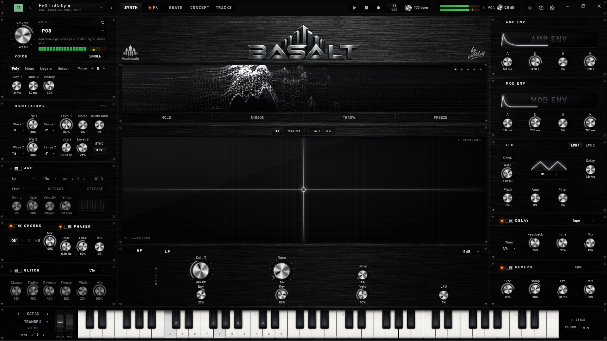

# Audiowald Basalt

**A music workstation (DAW) for Windows** - fourteen synth models, a pad sampler and drum machine, an
auto-accompaniment that follows your chords, multitrack recording and arranging, a song-writing assistant and a
complete piano course, in one app that runs offline.

  

This repository holds the versions only (no source code).

---

## Install

1. Download `Audiowald-Basalt-Setup-<version>.exe` from the newest entry under **Releases**.
2. Run it. If Windows warns ("Windows protected your PC"), choose **More info → Run anyway** - the test
   versions are not signed yet.
3. Start Basalt. In the demo the top bar shows **DEMO** with the time remaining in the session.
4. With a **licence key** (**ENTER KEY** in the top bar) Basalt runs without limit and fully offline. The
   same key works on your other computers too.

**Updates** come by themselves: when a new version is out, **UPDATE** appears in the top bar - DOWNLOAD,
then INSTALL. Basalt closes, updates silently and starts again. Your sounds, songs and settings stay.

**VST3 plugin:** at the first installation the setup asks whether Basalt should also be installed as a VST3
plugin for your DAW. It goes to `C:\Program Files\Common Files\VST3`, where DAWs look for plugins (Windows
asks for permission). In your DAW load **Audiowald Basalt** as an instrument. The same licence key unlocks the
app and the plugin.

---

## What makes Basalt different

Most DAWs give you a timeline, a mixer and a box of plugins - learning to play, writing the song and
finding the sound are left to you. Basalt builds these into the workstation itself:

| | A typical DAW | Basalt |
| --- | :---: | :---: |
| Timeline, piano roll, recording, mixing, export | ✓ | ✓ |
| Synthesizers built in | a few, or plugins | **14 models, 815 presets** |
| Pad sampler and drum machine | plugins or separate | **built in (BEATS)** |
| Auto-accompaniment that follows the chords you play, live | – | **158 styles in 15 genres** |
| Song planning: form, keys, chords, playing patterns → finished tracks | – | **CONCEPT + assistant** |
| Learn to play the piano inside the music program | – | **12 levels, live jam units** |
| One key plays a whole chord with voice leading | rarely | **CHORD** |
| Vocal tuning, vocal studio chain and vocoder | plugins | **built in (VOICE)** |
| A speech synthesizer that sings your lyrics | – | **SPEAK** |
| Move sound in 3D with your hands in front of a camera (experimental) | – | **✓** |
| Persian tuning (dastgāh, koron and sori notes) on every track | – | **✓** |
| Runs fully offline, no account | varies | **✓** |

### Only in Basalt

- **A piano teacher inside the DAW.** Falling notes, finger numbers and hand diagrams through twelve
  levels - and in every level *live units* with accompaniment: echo a call by ear, jam freely, find chords,
  groove in the pulse, play with both hands, invent a motif. The music waits for you or keeps going and
  rates your timing. Anything you improvise can be **kept as a song track** with one click.
- **Accompaniment that listens.** Pick a style, play a chord - drums, bass, chords, pad and an ostinato
  follow you, with intro, two main parts, fills and an ending. Like an arranger keyboard, but recorded
  straight into your song.
- **Write a song from its form.** CONCEPT plans sections, keys, chord palettes that only offer chords
  that fit, and playing patterns for keys, strumming and bass. A 14-step assistant guides you through it;
  **Create Arrangement** turns the plan into five editable tracks.
- **Your hands as a controller** (experimental). A webcam or a phone sees your arms and hands (only points,
  never a picture): raise them to move the sound through the room, stretch to widen it, open, pinch or tilt
  to turn any sound parameter - or, with the 3D air keyboard (also experimental), play the keys in the air.
- **Tuning beyond the piano.** Persian tuning with dastgāh and tonic: koron and sori notes sound lower or
  higher on every track, changeable while you play.
- **Cinematic movement.** Micro pitch drift, spectral lift and an endless rising tone - and a global pitch
  drift that moves the whole song together.

---

## All features

**Sound**
- Fifteen synth models: classic polysynths (Six, Six-0, Six-106, Jove 8, Oberon X, Prophetic 6, P08), a
  fat mono / poly synth (Voyage), six-operator FM (Hex 7), modern virtual analogue (Hyper), Raw (three plain
  oscillators for sharp saw chords), an acoustic
  **Piano** (physically modelled - strings, felt hammer, soundboard - or recorded Grand and Upright), sound
  clouds from recordings (Texture, Spectra) and a Sampler.
- 865 presets; every change you make to a preset is remembered.
- Two layers per sound (STACK or SPLIT), unison, glide, JUST (pure tuning on every chord), two LFOs, an 8-slot modulation matrix, XY pad.
- Arpeggiator, a 16-step SEQ that plays chords in your scale, an 8-step GATE.
- MPE controllers, MIDI keyboards, the on-screen keys or the computer keys.

**Effects**
- Chorus, phaser, tape / ping-pong delay, reverb (room, plate, hall, cathedral, non-linear; shimmer and gate)
  and a per-track glitch (stutter, reverse, freeze, pitch).
- Ambient tools: fracture, grain, fold, resonator, spectral (smear, freeze, shift, morph) and space.
- Cinematic motion and global pitch drift; an analogue mastering stage (tube, tape, glue, width) and EQ;
  low cut, mono bass, multiband, true-peak limiter and a loudness meter in LUFS.

**Chords and accompaniment**
- CHORD: one key plays triads, 7ths, 9ths, sus or power chords in your key and scale - with voicings,
  extra notes above or below, a bass note and automatic voice leading; HZ, the wide film-score chord; Form,
  the same chord on every key (m7, m9, m11 ...) for techno stabs.
- PULSE: the chord as a rhythm - 62 patterns: cinematic pulses, piano accompaniments (art-pop, classical,
  waltzes) and techno / electronic stabs, basslines and arpeggios.
- STYLE: 158 accompaniment styles in 15 genres following the chord you play.

**BEATS**
- 9 to 32 pads: load or record sounds, chop them by hits or grid or live, assign slices to pads.
- Pattern recording with overdub, count-in and quantize; note repeat (also triplets), velocity and pitch
  levels, choke groups, one-shot / gate / loop pads.
- Ten drum tracks (synthesis and recorded strikes), 100 kits, four patterns up to eight bars, chains,
  drum bus and glitch. Write patterns into the song or resample them into a new sound.

**Song**
- CONCEPT and the Composition Assistant (see above).
- EXPAND LOOP: a loop of 4 to 16 bars becomes a whole song in one of 9 genres, with transitions.
- TRACKS: record keys, knob moves and the microphone (with count-in and metronome); piano roll with chord
  tool, quantize and automation; arranger for whole bars and clips across all tracks; faders, mute and solo;
  undo for the whole song.
- Piano roll: notes and chords that glide into each other voice by voice, and chord suggestions - the next
  chord with 1 to 4 notes changed, in your key, borrowed, dark or shifted whole.
- A channel strip on every track and the drum lane: octave, semitones and cents, low cut, EQ, a 16-band graphic EQ with 20
  presets, compressor, sidechain ducking (by a pad, the drums or another track), drive and width.
- IMPORT: MIDI files, audio stems, a folder or a ZIP (from AI music services, sample sites and others) as tracks; → NOTES turns an
  audio track into notes (drums always, melody, bass and chords with Audio → Notes); audio files straight into
  an audio track, edited there with the sample editor's tools.
- Saved songs carry their audio in a folder beside the song.
- Export the song as WAV, MP3, OGG or FLAC, also every track as its own file; or as an MP4 video with
  14 kinds of pictures, and record the app live with its sound.

**Plug-ins**
- Your own VST3 instruments and effects (64-bit): a plug-in plays a track, up to four effects on every track,
  the drums and the master - each with its own window, saved with the song and in the export.

**Voice**
- Tune your singing (natural or hard tune) to the key, the chord or the notes you play; a lead-vocal
  studio chain; formant, robot and harmony voices; a vocoder that lets your voice - or a recorded or
  imported vocal - shape another sound.
- SPEAK SYNTHESIZER: type words and Basalt speaks or sings them, one syllable per note, in English or
  German, with 20 ready voices - also through the vocoder as a robot voice. A see-through head speaks along.

**Learn**
- Twelve levels from the first three keys to your own performance; Wait for me, Play through or Listen;
  tempo, hands, sections and repeat; points, accuracy and timing; live units in every level; play freely
  over any piece and listen back.

**More**
- AI features, 100% optional - Basalt is complete without them: Audio → Notes, Voice → Instrument,
  Accompany and Text → Notes, each downloaded and switched on in Settings → AI.
- Assign buttons, faders and knobs of your MIDI controller with LEARN.
- Six themes: Basalt (brushed black), Dark, Graphite, Grey, Silver and Light.
- The **?** in the top bar explains every page.

---

## Changelog

The same list is in Basalt: **Settings → CHANGELOG**.

### 0.3.1 - 2026-11-22

- Expand Loop: a loop becomes a whole song - 9 genres, roles for the tracks, calmer verses, transitions, preview; one undo step.
- Video: the song as an MP4 with 14 kinds of pictures (3D, piano roll, keyboard, falling notes ...); live recording of the app with its sound (Ctrl+Shift+R).
- Raw: a new model for sharp saw chords, with unison and new sounds (Pure Chords). JUST: pure tuning on every chord, for every model.
- FX / Mastering: Low Cut, Mono Bass, Natural, Multiband, True-Peak Limiter and a loudness meter (LUFS) - all off at first. Analog Master: Warmth is stronger.
- Reverb: Cathedral and Non-Linear, and Low Cut, Shimmer and Gate.
- Export: the loop repeated 1-64 times, a fade-out; Whole song ends where the music ends.
- Piano roll: zoom out to the whole song, Ctrl+wheel zooms at the pointer, the view runs along while playing; right click deletes a note; a clicked note's length is used for the next ones.
- Channel strip PITCH: Semi and Fine. The keyboard at the bottom shows the song's notes while it plays.
- Chords: no unwanted rubs (Sus2 / Sus4 in the scale, clean 7ths and 9ths); SUGGEST never offers a chord the track already has.
- The app opens maximized; the start screen goes away sooner.

### 0.3.0 - 2026-11-18

- Sidechain ducking: DUCK in every channel strip - a pad (Kick ...), the whole drum lane or another track pulls the track down. TRIGGER (every hit the same) or COMP (a louder hit ducks deeper), Amount, Release as a note value in time with the tempo, GHOST: a muted source still ducks.
- Arranger clips: BARS | CLIPS above the arranger. Make clip in the piano roll (Ctrl+G or right click on the selected notes), AUTO CLIPS by the gaps; drag clips (Ctrl: copy), onto another track, resize them at their edges, right-click menus for clips and bars.
- Audio tracks: import a file (WAV, MP3, OGG, FLAC, AIFF) into an existing audio track - the symbol at the far right of its head, Import audio here in the arranger's right-click menu, or drop it on the track. IMPORT… puts every stem in as a clip.
- Audio tracks: the sample editor's tools above the selected clip - crop, silence, normalize, gain, fades, reverse, trim, slices into clips (also shuffled), tape speed, filters. Every edit keeps the original.
- Channel strip: PITCH - an Octave knob on instrument tracks, 4 octaves down to 4 up; the middle plays as written.
- Piano roll SUGGEST: CPro - the next chord of a progressive-house progression in its colours; with nothing selected, a first chord at the cursor.
- Synth LFOs: 32/1, 16/1 and 8/1 for very slow filter sweeps.
- Hyper: band distortion after the filters - Band, Span and Dist with a small screen showing the band; the crusher's sample-rate reduction works now. New wide saw sounds on Hyper.
- BEATS: the sequencer shows 1-16, 17-32 or ALL steps, always square; a step set past the end lengthens the pattern.
- PULSE: two more patterns, Golden and Golden 2 - a broken chord over 13 beats.
- TRACKS: right click on a track's head → Duplicate; a click in the arranger shows that bar in the roll; STOP always goes back to the start; undo, redo, cut, copy, paste and empty beside SAVE; New, Open and Save as icons.

### 0.2.9 - 2026-11-15

- Chord glide: in the piano roll, notes and whole chords connect and glide into each other without a break, voice by voice - wide gliding pads. Glide tool (5), Connect notes (G) for the selected chords, a wheel for the glide time, struck again where it arrives if you like. On every synth model, the Piano and the Sampler, and on VST3 instruments with note expression.
- CHORD: HZ - root and third only, each as an octave, wide apart: the big film-score chord. Spread, AUTO, Up, Down and BASS work with it.
- CHORD: PULSE plays the chord as a rhythm - 20 cinematic pulses, 30 piano accompaniments (art-pop, classical, ballads, six waltzes) and 10 techno and electronic patterns (stabs, rolling bass, trance gate, arpeggios). Recording takes the notes you heard, from the first strike on.
- CHORD: Form - every key plays the same chord on itself (m7, m9, m11, Maj7, Maj9, 7, Sus4, fifths, fourths), like the chord memory of Detroit techno.
- Piano roll: chord suggestions (SUGGEST) - the next chord a bar later with 1 to 4 notes changed, in your key; ♭ allows a borrowed note, ♭2 the dark flat second, ∥ shifts the whole shape. Tab for another, Enter takes it and the next one follows.
- CONCEPT: a new progression family, Electronic - short loops of techno, synth-pop and electronica.
- TRACKS: CLICK keeps the metronome going through the recording after the count-in; ■ STOP beside PLAY while something plays.
- Arranger: every track in its colour with light notes and waveforms and clear gaps between the rows; piano roll: stronger lines every 4 and 8 bars.

### 0.2.8 - 2026-11-13

- VST3 plug-ins: your own instruments and effects in Basalt (64-bit VST3). TRACKS, under the tracks: INSTRUMENT - a plug-in plays the track, OPEN shows its window; EFFECTS - up to four effect plug-ins on every track, the drums and audio tracks. FX → MASTERING: four more on the whole mix.
- Settings → Plug-ins · VST3: the folders searched and SCAN; new and changed plug-ins are found when Basalt starts. A plug-in's settings are saved with the song and are in the export.
- A plug-in that crashes is switched off and the sound comes back at once; ON switches it on again. Plug-in windows wear the app's theme.
- Themes in Settings → Appearance: Basalt (brushed black, the default), Dark, Graphite, Grey, Silver and Light - with readable text in every one.
- Piano roll: taller or flatter rows - Alt+wheel over the roll or the two row buttons beside the magnifiers.
- Your page settings (theme, page, head size and more) are kept safely from one start to the next.

### 0.2.7 - 2026-11-12

- SPEAK SYNTHESIZER (FX → VOICE): Basalt speaks and sings your words - type a text, every note says the next syllable; WORDS → NOTES writes them into the track, ROBOT VOICE sends them through the vocoder; 20 ready voices, English and German.
- While a track speaks, a see-through head speaks along over every page - drag it anywhere, HEAD SIZE in the SPEAK panel.
- TRACKS: a 16-band graphic EQ in every track's channel strip and the drum lane, with 20 presets for vocals, drums, bass, synths, keys and more.
- TRACKS: IMPORT… takes MIDI files, audio stems, a folder or a ZIP (from AI music services, sample sites and others) - up to 16 tracks.
- TRACKS: → NOTES turns an audio track into notes - drums onto the drum lane, melody, bass or chords with Audio → Notes.
- TRACKS: VOCODER on audio tracks - a recorded or imported vocal becomes the voice of another track's sound.
- Saved songs carry their audio: recordings, stems and pad samples go into the folder <song>.assets beside the song.
- TRACKS: the stop button is PAUSE and keeps the position; stronger track colours.
- Exclusive mode: the pitch no longer sinks and the sound no longer drops out after a few minutes in busy passages.
- 3D air keyboard (experimental): the keys stay under your hand; a held note bends with the hand like on an MPE keyboard.

### 0.2.6 - 2026-11-11

- Master EQ: Treble is audible now - a broad treble control like a hi-fi's, from about 2 kHz up.
- The level meter in the header shows the whole output; SYNTH screen: a small switch in its top left corner shows the synth alone or the whole output.
- TRACKS: NEW starts from scratch - one empty track, every sound, effect and setting at its default.
- Settings: headphones switched on, microphones and cameras plugged in appear in the lists within seconds - Basalt stays on the output it plays on.
- Hand tracking and the 3D air keyboard are marked experimental, the AI features 100% optional.

### 0.2.5 - 2026-11-10

- VST3 plugin: the setup asks at the first installation whether Basalt should be installed as a VST3 plugin for your DAW too (C:\Program Files\Common Files\VST3). Updates renew it, uninstalling removes it.
- The plugin takes the same licence key as the app; without a key it runs 15 minutes per DAW session.
- Drum bus: the standard level is −9 dB (every drum kit, and double-click on Level).

### 0.2.4 - 2026-11-10

- Any MIDI keyboard works without setup: the knobs start with the General MIDI 2 controls (CC 74 cutoff, 71 resonance, 73 attack, 72 release, 91 reverb), transport buttons and faders work in the DAW mode most keyboards have and with MIDI Machine Control. Everything else: LEARN.
- Settings → MIDI inputs: KEYS or DAW for every input - a keyboard on a MIDI interface's second input now plays.
- Settings no longer start with one keyboard model's layout; that model's extras appear only when it is connected.
- Changelog in Settings.
- The version beside the logo is smaller and sits on the logo's bottom line.

### 0.2.3 - 2026-11-10

- The version is shown beside the BASALT logo and in the Settings title.

### 0.2.2 - 2026-11-10

- 3D air keyboard: play the app's keyboard with your fingers in the air in front of a webcam, the hands drawn over the keys - Settings → Camera · Hands, START and PLAY (experimental).
- AI: Voice → Instrument, Accompany and Text → Notes can be downloaded in Settings → AI (Sing → Notes as before).
- Learn: load your own songs (My songs) and transpose them with − / +.
- Piano (recorded Grand and Upright): no more silent keys.
- TRACKS: the arranger zoom and the bar tools sit beside Bars / Snap - more room for the arranger.
- Hands: hand models on the keyboard and in the 3D view, SHOW PICTURE to aim the camera.
- MPE: the controller's configuration and bend ranges are read.

### 0.2.1 - 2026-11-08

- SYNTH screen: live 3D views of the sound - landscape, wavetable, coil, an underwater world and sound figures.

### 0.2.0 - 2026-11-07

- BEATS: a pad sampler with 9 to 32 pads - record, chop and slice sounds, sample effects, a sequencer for all pads; the drum machine is part of BEATS now.
- New drum sounds from synthesis and recorded strikes.
- CONCEPT: the Composition Assistant sits in the arrow toolbar.
- The Basalt app icon.

### 0.1.4 - 2026-11-06

- The help (?) explains every page.

### 0.1.3 - 2026-11-06

- Licence & updates at the top of Settings.

### 0.1.2 - 2026-11-06

- Updates install silently; Basalt looks for them at start and every 30 minutes.

### 0.1.1 - 2026-11-06

- The demo: every feature, 15 minutes per session.

### 0.1.0 - 2026-11-06

- The first test version.

---

## Feedback

Tell us what you liked, what was unclear and what went wrong - with the version number (Settings, top
line) and, if you can, a screenshot.
